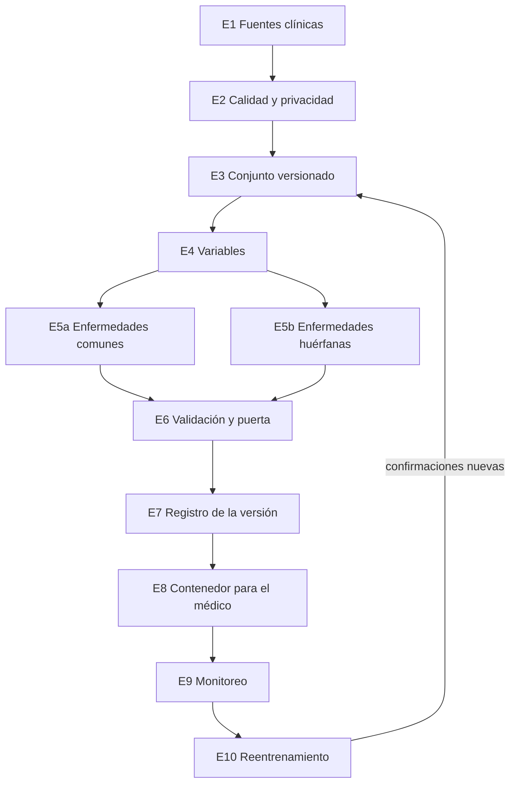

# Pipeline de MLOps: posible enfermedad a partir de síntomas

## 1. Problema

Un médico tiene síntomas y datos clínicos básicos de un episodio. El sistema debe estimar si es posible que esa persona tenga una enfermedad. Hay dos realidades de datos:

- Enfermedades comunes: muchos pacientes ya confirmados. Se puede entrenar, calibrar y comparar contra un modelo simple.
- Enfermedades huérfanas: muy pocos casos, a menudo confirmados tarde. Un modelo entrenado para acertar la mayoría aprende a ignorarlas. La exactitud sube justo cuando la enfermedad rara se pierde.

La salida es una estimación con confianza, para que el médico decida. Si no hay casos suficientes de una enfermedad concreta, el sistema lo dice (alerta de patrón poco frecuente) en lugar de ponerle un nombre. No es un diagnóstico automático.

El médico ve, además, un resumen estable en cuatro estados: `NO ENFERMO`, `ENFERMEDAD LEVE`, `ENFERMEDAD AGUDA` y `ENFERMEDAD CRÓNICA`. Esos estados salen de la probabilidad del modelo y de la duración, con cortes acordados con el equipo clínico. Mientras no haya un modelo entrenado, el servicio responde con una función determinista y el mismo contrato.

## 2. Diseño

### Restricciones

- Privacidad. La historia clínica es un dato sensible (Ley 1581 de 2012). Se minimiza, se seudonimiza y el entrenamiento no ve nombre ni documento.
- Etiqueta tardía. En una huérfana, “sin diagnóstico hoy” puede ser “aún no confirmada”. La fecha de la consulta y la fecha de confirmación se guardan por separado.
- Desbalance. Hay clases con decenas de casos y clases con miles. La exactitud no sirve como objetivo.
- Solapamiento. Fiebre, dolor y duración no identifican una sola enfermedad. La salida es compatibilidad, con un nivel de confianza.
- Códigos distintos entre sedes. Hace falta un diccionario de síntomas con versión.
- Error asimétrico. Perder una huérfana pesa más que una alerta que el médico descarta. El umbral de esas clases lo fija el equipo clínico.
- Uso. La respuesta cabe en segundos. El médico puede correr el servicio en su equipo, dentro de un contenedor, o el hospital lo publica en su red.
- Enfermedad ausente. Por debajo de un mínimo de casos no se crea una clase con nombre.
- Alcance. Esta versión apoya la decisión del médico. Un uso asistencial pide validación clínica y el marco regulatorio que corresponda.

### Datos

| Tipo | Ejemplos | Papel |
| --- | --- | --- |
| Contexto | edad, sexo | Ajuste; no son el único predictor |
| Síntomas | fiebre en °C, dolor de 0 a 10, días, número y códigos | Entrada principal |
| Laboratorio | resultados ya estructurados, si la sede los tiene | Opcional en la primera versión |
| Etiqueta | confirmado, sospecha que luego se confirma, o sano ya revisado, con fechas | Supervisión |
| Metadatos | sede, fecha, versión del diccionario | Deriva y auditoría |

La nota clínica libre y las imágenes quedan para una versión posterior. La unidad para partir los datos es el paciente: varias consultas de la misma persona no pueden quedar a la vez en entrenamiento y en prueba.

### Fuentes y manejo

- Historia clínica de la sede, por lotes.
- Confirmación del especialista, del laboratorio o del estudio genético: es la etiqueta de calidad.
- Catálogo de fenotipos de enfermedades huérfanas, para saber qué síntomas son plausibles. No se mezclan pacientes de repositorios públicos que no hayan pasado el control de calidad.

Cada lote es inmutable, tiene identificador y fecha, y el conjunto de datos cita los lotes que lo componen.

### Arquitectura

Un solo flujo de datos y dos tratamientos de modelo:

- Comunes: clases con al menos 200 pacientes confirmados. Ese mínimo se acuerda con el equipo clínico y queda escrito en la ficha del modelo.
- Huérfanas: de 20 a 199 pacientes. Reutilizan la representación de síntomas del modelo común y se adaptan con pocos ejemplos.
- Por debajo de 20 no hay clase con nombre. Hay alerta genérica y el caso queda para el especialista.

## 3. Etapas

Cada etapa tiene una condición para avanzar. Sin esa condición no se promueve el modelo.

### E1. Ingesta

- Entra: extracción de la historia clínica y confirmaciones.
- Sale: lote crudo, solo lectura.
- Sigue si: el esquema se reconoce y el lote queda identificado, sin pisar un lote anterior.

### E2. Calidad y privacidad

- Entra: lote crudo.
- Sale: lote aceptado, o rechazo con informe.
- Sigue si: los campos obligatorios están, los rangos clínicos cierran (fiebre, dolor, días, conteo), no hay consultas duplicadas y los identificadores directos quedaron aparte. Un lote rechazado no entra a entrenamiento.

### E3. Conjunto de datos versionado

- Entra: lotes aceptados.
- Sale: conjunto `vN` con un manifiesto (pacientes, casos por clase, fechas, sede).
- Sigue si: el conjunto es inmutable y cada experimento futuro lo cita. La partición es por paciente. Un bloque de otro período queda fuera y no se usa para elegir umbrales.

### E4. Variables

- Entra: conjunto `vN`.
- Sale: matriz de variables y el diccionario de síntomas de esa versión.
- Sigue si: el mismo código de preparación corre en el entrenamiento y en el servicio. Un síntoma desconocido se marca; no se improvisa un código.

Entrada mínima de la primera versión: fiebre, dolor, días, número de síntomas, edad y sexo.

### E5a. Modelo de enfermedades comunes

- Entra: variables de las clases que superan el mínimo.
- Sale: un modelo de referencia interpretable (regresión logística) y el modelo principal (potenciación de gradiente sobre la tabla de síntomas).
- Sigue si: el candidato iguala o mejora la puerta de E6 frente a la referencia.

### E5b. Modelo de enfermedades huérfanas

- Entra: la representación de síntomas ya entrenada y los casos raros.
- Sale: una adaptación de pocos ejemplos (prototipos o una capa ajustada), o la decisión explícita de no nombrar la clase.
- Sigue si: hay al menos 20 confirmados, o queda documentado que solo habrá alerta genérica.

No se entrena un modelo profundo desde cero con un puñado de casos. Un aumento de datos, si se usa, es una variación clínica revisable, no un paciente inventado presentado como real.

### E6. Validación y puerta de promoción

- Entra: candidato, validación (ahí se elige el umbral) y una prueba que se mira una vez.
- Sale: informe de sí o no, y la ficha del modelo.
- Sigue si: se cumple la métrica del régimen y un médico revisó una muestra de falsos negativos.

Partición de partida: 70 % entrenamiento, 15 % validación y 15 % prueba, por paciente, más el bloque de otro período. Si una clase tiene menos de 50 pacientes, esa clase se valida dejando un paciente fuera en cada vuelta.

- Comunes: el candidato se promueve si iguala o mejora la sensibilidad de la regresión logística en el umbral clínico y la calibración no empeora. En cada tramo de probabilidad, la frecuencia observada se mantiene cerca de la probabilidad anunciada.
- Huérfanas: el candidato se promueve si la sensibilidad de la alerta es al menos 0,80 sobre los confirmados de prueba. La métrica de apoyo es PR-AUC. La exactitud global no es puerta.

El servicio se prueba aparte de las métricas del modelo: cuatro casos deben caer uno en cada estado, y fiebre, dolor, días o conteo fuera de rango se rechazan. Esas pruebas corren sobre la imagen.

### E7. Registro

- Entra: candidato aprobado en E6.
- Sale: versión inmutable (datos `vN`, código, métricas, umbrales).
- Sigue si: lo que va a correr es exactamente lo registrado. No se despliega un archivo suelto.

### E8. Despliegue

- Entra: versión registrada.
- Sale: imagen de contenedor con página para el médico y API.
- Sigue si: la imagen se construye, los cuatro casos fijos responden bien y la versión de la imagen es la versión del modelo.

El médico ejecuta el contenedor en su equipo, o el hospital lo publica en la red interna. La respuesta lleva estado, razón y versión. La historia clínica no sale a un servicio público. La imagen publica la función en el lugar del modelo hasta que exista el entrenamiento.

### E9. Monitoreo

- Entra: consultas reales y, cuando llegan, confirmaciones.
- Sale: alertas.
- Sigue en observación permanente.

Se vigila la latencia y los errores, la proporción de cada estado, y los síntomas fuera del diccionario (alerta si superan el 5 % de las consultas). También se alerta si la proporción de episodios con fiebre de 38,5 °C o más, o con 90 días o más, se desplaza más de 10 puntos porcentuales frente al conjunto de entrenamiento. Esos cortes coinciden con el lenguaje de los estados que ve el médico.

La sensibilidad real se recalcula cuando la etiqueta madura, sobre todo en huérfanas. Esa cifra no se puede ver el día del despliegue.

### E10. Reentrenamiento

- Entra: etiquetas nuevas o una alerta de E9.
- Sale: un candidato que vuelve a E5.
- Reemplaza al modelo vigente solo si gana otra vez la puerta de E6.

Un episodio sin diagnóstico permanece sin etiqueta hasta cumplir 12 meses, o hasta que aparezca una confirmación. Entrenar ese episodio como sano enseña al modelo a borrar los casos que hay que encontrar. E10 solo usa etiquetas ya maduras.

Las comunes se reentrenan cada trimestre, o el mismo día de una alerta de deriva. Las huérfanas se reentrenan solo cuando entra un grupo nuevo de confirmaciones: un calendario vacío las haría oscilar. Una enfermedad nueva sin casos locales no crea una clase; sigue la alerta genérica y queda escrita la carencia.

## 4. Diagrama

El dibujo está en [diagrama-pipeline.svg](diagrama-pipeline.svg). La línea verde devuelve las confirmaciones nuevas a E3. Un candidato que no pasa E6 no se despliega.

## 5. Servicio

`servicio/` implementa E8. La función `predict_state` ocupa el lugar del modelo entrenado. El médico ve el mismo contrato: cuatro entradas y uno de cuatro estados. Cuando exista el modelo real, se sustituye la función dentro de la misma imagen, sin cambiar la forma de usarla.

## 6. Fuera de esta versión

Texto libre de la nota clínica, imagen diagnóstica y certificación como dispositivo médico. Entran después por el mismo camino: variables nuevas en E4, la misma puerta E6 y la misma imagen en E8.
